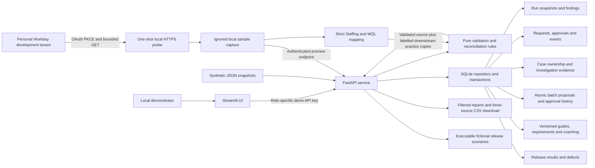

# Architecture

## Current local design

Solid edges are implemented. A five-worker personal-tenant API read was verified locally.
Staffing/WQL mapping and audit import are implemented for a five-worker sample. Tokens are not
persisted, and the UI shows a saved capture, not a live session. No Flight Centre systems are connected.

## Data flow

The API validates JSON structure through Pydantic, then invokes a pure audit function.
Rules normalise IDs for matching, quarantine duplicate keys and compare only the documented
current-employee population. The SQLite repository persists each run, findings and workflow history.
The UI never accesses the database directly.

For corrections, an analyst requests a cost-centre change. A reviewer approves it. An operator
applies it inside a write transaction only if the source still matches the reviewed value.
The service reruns the rules before committing; unresolved target findings or new exceptions
roll back the entire operation. A second application returns the existing applied status.

## Decisions

- **Modular monolith:** fast local feedback and clear business rules; split jobs only when measured load warrants it.
- **FastAPI:** request validation and an inspectable API contract.
- **Streamlit:** quick analyst-facing demonstration; not intended as an enterprise identity boundary.
- **SQLite:** portable local state. Single-writer contention and unpaginated responses constrain scale.
- **Pure rules:** validate edge cases without web/database dependencies.
- **Explicit ownership:** a mock HR-authoritative cost-centre policy, not majority voting between systems.
- **Approval before mutation:** no automated direct write-back to a real HR platform.

## Trust boundaries

The local role selector has access to all three demo keys. It proves server-side role enforcement,
not independent human approval. Audit events are ordinary database rows, not immutable records.
All users can read all synthetic runs. Production needs individual SSO identities, scoped access
and independently protected audit storage before handling employee data.

## Expanded workflow and storage

A run stores both the original capture and a working copy. Corrections change the working copy;
original captures remain available for explaining what was first observed. Legacy runs are labelled
migration_current_state because their true original source rows cannot be reconstructed.
Source dates are compared before cross-system reconciliation: mismatched captures create a timing
finding and prevent corrections until a new aligned capture is supplied.

The case workspace records a responsible team, priority, evidence, uncertainty, next action and
follow-up date. An optimistic version check prevents overwriting another saved investigation.
Batches apply all reviewed rows in one database transaction, or save none of them. A stale row
invalidates the proposal. Rejection and cancellation preserve the decision history.

Documents retain successive versions. A simulated requirement needs reviewer acceptance. A defect
is linked to a failed executable scenario; resolution requires matching passing retest evidence.
These are local teaching controls, not Workday business processes or production audit guarantees.

Schema version 2 adds run_context, case_work, batches, lab_events, documents and test_runs.
The startup migration preserves old runs and changes. Back up the database before upgrading.

## Workday sample audit policy

Imported runs carry their capture hash/time, field map, employee-to-internal-ID mapping and scoped
reference policy in run_context. Their HR snapshot is read-only through single/bulk corrections.
Payroll/Core are explicit local copies. The optional training mode injects two logged errors only
into those copies. Cost-centre reference validation is limited to assignments resolved in the
capture, not the full active finance master. Managers outside the sample are checked against
separately resolved Staffing IDs. Native sample runs compare FTE ratios against the captured HR
source as well as checking range, so a wrong but numerically plausible correction cannot pass.
Legacy runs retain their original C100/C200/C300 policy and findings.
