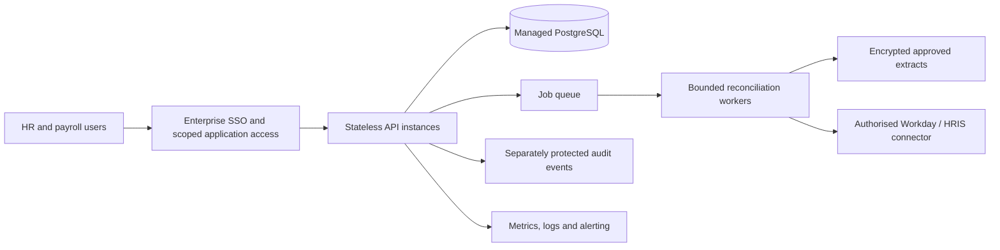

# Production and scalability plan

## Current boundary

v0.2.1 is a local learning demo with fictional audit datasets and an optional personal-tenant API capture. Production mode deliberately fails closed. No cloud
resources, employer integrations or public deployment are provisioned. Container configuration
is not a claim of production readiness. Actual Docker verification is recorded by CI results.

## Target architecture after requirements discovery

This is a proposed architecture, not deployed infrastructure. Validate actual scale, retention,
security, hosting region and HR platform policies before choosing services.

## Scale in response to evidence

1. Measure file sizes, worker counts, concurrent analysts and p95 audit latency.
2. Add paging and upload limits; reject malformed or oversized files before parsing.
3. Move SQLite to PostgreSQL with proper migrations, indexes and concurrency tests.
4. Put large imports in idempotent asynchronous jobs with retries, quotas and cancellation.
5. Store approved extracts outside the database; minimise fields and enforce retention.
6. Scale workers based on queue depth and measured memory per batch. Preserve run lineage.

SQLite currently uses write transactions even for reads and serialises access; snapshots are JSON
blobs and list endpoints are unpaginated. Those are explicit prototype constraints. No benchmark
has established a supported production workload.

## Release pipeline

Current: PR/push → lint and format → domain/API tests with coverage gate → dependency audit →
container build and health checks. Action references are SHA pinned; dependencies are hashed.

Next: create an immutable image/SBOM, scan OS packages and secrets, pin base-image digests,
deploy staging, run contract/UAT/load checks, review migration and rollback, obtain release approval,
then deploy and monitor. Use workload identity/OIDC rather than stored cloud access keys.
No production CD workflow is enabled before a target environment is approved.

## Operations and recovery

Define availability, latency, reconciliation completion and exception-age objectives with users.
Alert on job failures, unexpected data-volume changes, repeated authentication failures and ageing
high-priority cases. Keep logs minimal and never log raw employee extracts or credentials.

Before changing storage, perform an actual backup/restore drill and record evidence. For local
SQLite, stop writers before copying the database; do not describe an untested file copy as a
recovery solution. Production backups need encryption, isolation, tested restoration and agreed
recovery-point/recovery-time objectives.

## Release checks not yet satisfied

SSO/tenant access, privacy review, real connector contracts, schema migrations, protected audit
logs, backup restoration, load tests, penetration testing and production sign-off remain outstanding.
